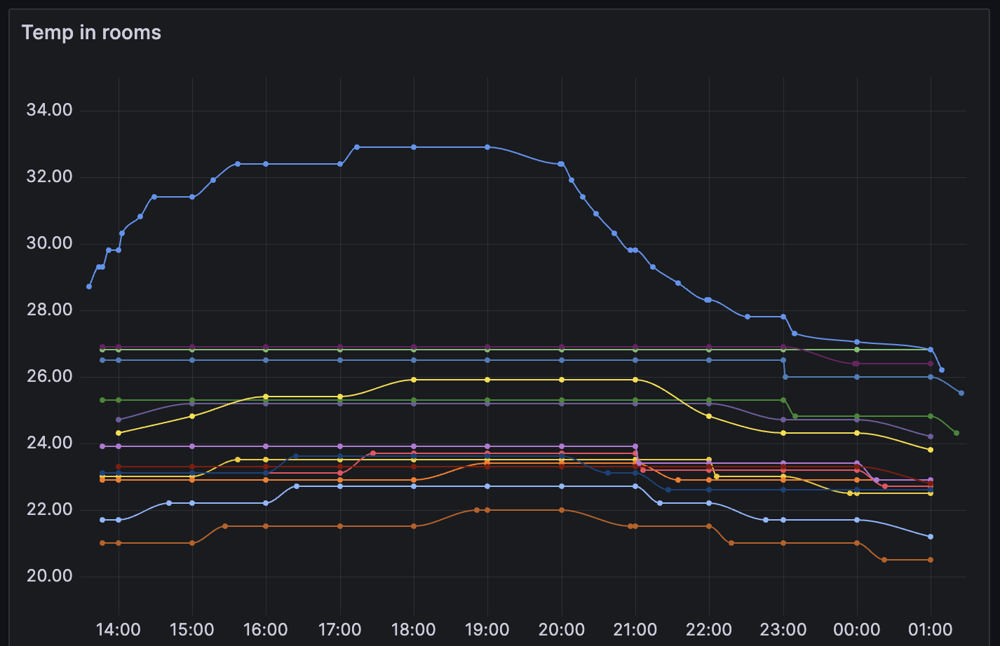

# SprutHub Scenarios

Коллекция сценариев для SprutHub — автоматизация умного дома.

## CI

Тесты запускаются на Node.js 20 при push и pull request:

- GitHub Actions: [`.github/workflows/tests.yml`](.github/workflows/tests.yml).
- Forgejo Actions: [`.forgejo/workflows/tests.yml`](.forgejo/workflows/tests.yml).

Для Forgejo нужен доступный runner с меткой `ubuntu-latest`, Node.js для
запуска actions и доступом к GitHub и nodejs.org. Полные URL actions явно
задают источник независимо от настройки `DEFAULT_ACTIONS_URL` сервера.

Локальная проверка:

```bash
node logic/test-runner.js
node --test tests/*.test.js
```

## Сценарии

### AWTRIX Temperature Display

Отображение температуры с датчиков на часах Ulanzi TC001 (AWTRIX 3).

- Все датчики → все часы
- Цвет по температуре (фиолетовый → синий → зелёный → красный)
- Автоматическая настройка часов при сохранении сценария

**Документация:** [docs/awtrixTemperature-setup.md](docs/awtrixTemperature-setup.md) | [Тесты](docs/awtrixTemperature-tests.md) | [Статья на sklukin.ru](https://sklukin.ru/posts/ulanzi-awtrix-temperature/)

---

### AWTRIX Garage Door Indicator

Индикатор статуса гаражных ворот на часах Ulanzi TC001 (AWTRIX 3).

- Мигающий красный индикатор когда ворота не закрыты
- До 3 ворот одновременно (indicator1, indicator2, indicator3)
- Мгновенная реакция без задержки
- Автоматический сброс индикаторов при сохранении сценария

**Документация:** [docs/awtrixGarageDoor-setup.md](docs/awtrixGarageDoor-setup.md)

---

### Outlet Scheduler

Управление розетками по расписанию — автоматическое включение и выключение.

- Несколько розеток с индивидуальными расписаниями
- Выбор из предустановленных интервалов (15 мин, 30 мин, час, 2 часа, 6 часов, сутки)
- Настраиваемая длительность включения
- Автоматическая валидация: длительность не превышает период расписания

**Примеры:** аквариумный компрессор, увлажнитель, автополив растений

**Документация:** [docs/outletScheduler-setup.md](docs/outletScheduler-setup.md)

---

### Metrics Collection

Сбор метрик с датчиков и отправка в time-series базы данных для визуализации в Grafana.



**Возможности:**
- Сбор данных с температурных, влажностных, CO2 датчиков
- Мониторинг потребления энергии (ваттметры, амперметры, вольтметры)
- Отправка метрик в InfluxDB и VictoriaMetrics
- Health check баз данных с уведомлениями в Telegram

**Файл:** `logic/statisticsSensors.js`

**Документация:** [docs/start.md](docs/start.md) | [Статья на sklukin.ru](https://sklukin.ru/posts/spruthub-grafana/)

**Дашборды и алерты Grafana:** [grafana/](grafana/) — JSON в репозитории, заливка скриптами ([docs/grafana.md](docs/grafana.md))

#### Быстрый старт

```bash
# Запуск всех сервисов одной командой
cd docker && docker compose up -d
```

#### Почему две базы данных?

| База | Назначение | Retention |
|------|------------|-----------|
| InfluxDB | Точные данные за короткий период | ~1 месяц |
| VictoriaMetrics | Долгосрочное хранение | 5 лет |

#### Как работает сбор метрик

```
logic/statisticsSensors.js
├── trigger() → мгновенная отправка при изменении датчика
├── cron (hourly) → отправка всех метрик
├── cron (minute) → обновление списка устройств
└── cron (30 min) → health check + Telegram alert
```

## Структура

```
logic/                    # Логические сценарии (с info блоком)
├── awtrixTemperature.js  # Температура на AWTRIX
├── awtrixGarageDoor.js   # Индикатор ворот на AWTRIX
├── outletScheduler.js    # Управление розетками по расписанию
├── statisticsSensors.js  # Сбор метрик
└── test-runner.js        # Тестовый раннер для Node.js
global/                   # Глобальные функции (sendToTelegram)
docker/                   # Docker Compose для баз данных
docs/                     # Документация и шаблоны
```
